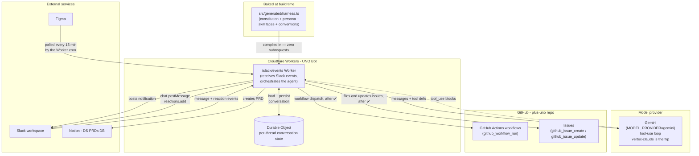
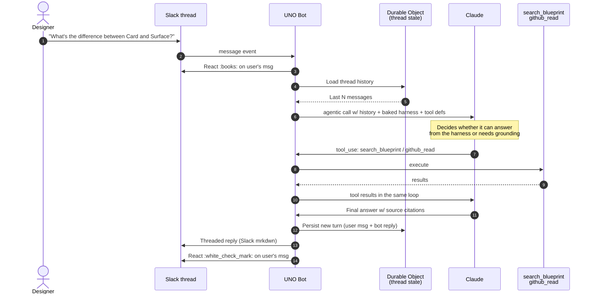
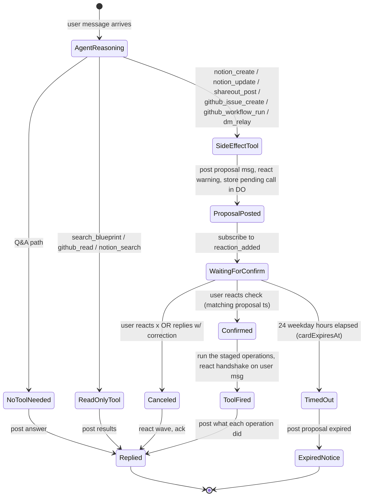

# UNO Bot v2 — Flowcharts

> Originally a Week-1 design deliverable. Author: Bryan • Date: 2026-05-20.
>
> **Audited against code 2026-08-24 (#158).** Every diagram below was checked
> claim-by-claim, not just the one that was obviously wrong. Three marketplace
> flows were **deleted** — the tools they diagram (`marketplace_search`,
> `marketplace_add`, `marketplace_edit`) do not exist in
> `agents/uno-bot/tool-definitions.json`, and the two stub workflows they
> dispatched to were deleted in the same change. The four that remain were
> **corrected**; each carries an audit note saying what was verified.
>
> **Updated 2026-10-14.** The implement flow is gone: the Worker no longer
> builds components or scaffolds prototypes, and `figma-implement.yml` no
> longer exists, so a Figma change reaches code through an intake the team
> picks up. The tools named below are the ones in `tool-definitions.json`.
>
> This is current-state documentation. A claim here that the code contradicts
> is a bug in this file — file it through `uno-maintain`.

## Overview architecture

The system around uno-bot: where it sits relative to GitHub Actions, Slack, Notion, Figma, and the model provider.

**Audit 2026-08-24 — corrected in four places.** The Figma poll is a Worker
cron (`src/figma-poll.ts`), not `figma-library-poll.yml`, which no longer
exists. The harness is **baked into the bundle at build time**
(`src/generated/harness.ts`) and served as a constant — the original diagram
had the Worker fetching skills from GitHub Raw on every invocation, which is
the opposite of what happens and the reason the bundle costs zero subrequests.
The model provider is **Gemini** (`MODEL_PROVIDER = "gemini"`, wrangler.toml),
not Claude via the Agent SDK. The marketplace dispatch box is gone.

Key points:
- **The Figma poll lives in the Worker.** `src/figma-poll.ts` runs on a Worker cron (`*/15 13-23 * * 1-5`), ported off GitHub Actions in July 2026. `figma-library-poll.yml` no longer exists.
- **The harness is baked, not fetched.** `bundle-harness.mjs` assembles it at build time from every doc declaring `embodiment: all | uno-bot`, and `src/agent/skills.ts` serves the constant. Zero subrequests, updates on deploy.
- **uno-bot never writes to the repo.** It files and updates issues and dispatches workflows, each behind a ✅. It writes directly to Notion and Slack.

---

## 1. Q&A flow

The default conversational mode. Designer asks a question; the agent answers, reaching for a tool only when it needs grounding.

**Audit 2026-08-24 — corrected.** The original diagram showed a two-pass
classify-then-fetch against `docs/product-and-service` and `docs/knowledge`, picking docs
from a knowledge map. That is not what happens: there is one agentic loop, and
grounding comes from tools the model calls — `search_blueprint` for journey
facts, `github_read` for design-system and rule-doc facts (`AGENT.md` §Tool
routing). The doc paths in the old diagram no longer exist either. Confirmed:
thread history really is loaded from and persisted to the Durable Object
(`src/thread-state.ts`).

Notes:
- Steps 4-5 are the **thread memory** — every Q&A call loads prior turns so "now do the same for Button" works.
- Steps 6-11 are **one tool-use loop**, not two passes. The model calls a tool, the Worker executes it, results return to the same conversation. Which tool for which question is each tool's description in `agents/uno-bot/tool-definitions.json`.
- No tool call = no confirmation gate. Q&A is the bot's "default" mode.

---

## 2. Confirmation-gate state machine (cross-cutting)

How the **confirmation gate** actually works at the platform level. This isn't a use-case flow — it's the orchestration pattern that all side-effect tools share.

**Audit 2026-08-24 — corrected in two places.** The retired `marketplace_add` /
`marketplace_edit` transitions are gone, and `marketplace_search` was the only
example of the read-only branch. A card expires **24 weekday hours** after
it is staged, counted in ET with Saturday and Sunday skipped (#1315,
`agents/uno-bot/src/card-expiry.ts`), not the 15 minutes the diagram claimed;
it is live through its exact deadline. Confirmed: pending proposals really are
keyed by the proposal message `ts` in the Durable Object.

Key behaviors:
- **State is stored in the Durable Object.** Keyed by the proposal message's `ts` (Slack message timestamp). When a reaction comes in, the Worker queries the DO by `item.ts` to find the matching pending call.
- **24 weekday hours on pending proposals** (`cardExpiresAt`, `agents/uno-bot/src/card-expiry.ts`; the store stamps it as the card's `ttlMs`). Prevents stale proposals from being fired days later; a card's last line says its deadline.
- **User can cancel via ❌ or correction.** If they reply with a correction, the agent re-prompts (back to ProposalPosted with updated parameters).

---

## What's NOT diagrammed here

- **Error states.** Each flow has error paths (the model fails, a write is refused, etc.) — not drawn to keep diagrams readable. The Worker should react `:x:` on user's msg + post error message in thread on any uncaught exception.
- **First-message-in-thread vs follow-up.** The Q&A flow above is a single turn. Multi-turn follow-ups ("now do that for Button") use the same flow with the thread history loaded.
- **Polling failure modes.** If the cron fails (Figma API down, Notion API down), it logs and retries on next cycle. Not bot-facing.

---

## Open questions on these diagrams

1. ~~**Confirmation TTL (15 min)** — right number?~~ **Settled:** 24 weekday hours, one rule for every card (#1315, `cardExpiresAt`).
2. **Should the `:warning:` reaction on the bot's proposal also work the other way — bot proposes → user reacts `:warning:` to mean "yes do it"?** That's confusing UX. Better: ✅ for confirm, ❌ for cancel, everything else ignored.

End of flowcharts.
